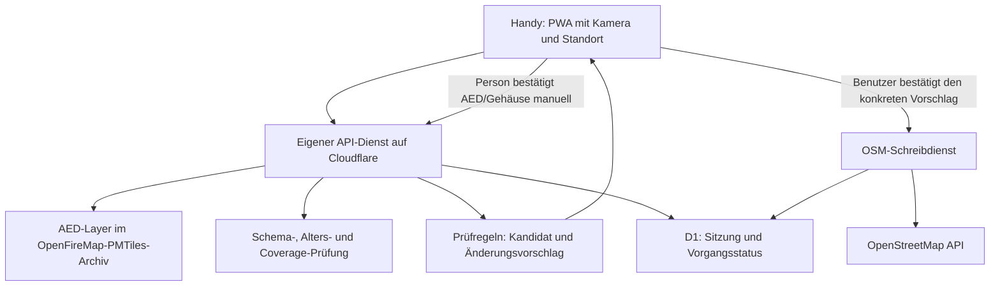

# Architektur und Bedienung für AEDjaeger

> **Aktueller Pilotentscheid (9.11.2026):** Der Produktablauf verwendet keine externe Bilderkennung und keine OpenAI-API. Fotos und EXIF bleiben auf dem Gerät; die Person bestätigt die Sichtbarkeit des AED selbst. Die Umkreissuche liest den AED-Layer aus dem bestehenden OpenFireMap-PMTiles-Archiv. Frühere Abschnitte zu Anbieterwahl, Modelltests und externer Bildverarbeitung dokumentieren ausschließlich den historischen Prototyp und sind keine aktuelle Architekturvorgabe.

Stand: **9.11.2026**. Cloudflare Workers Free ist als Hosting-Richtung gewählt. Der Bedienprototyp nutzt Vite und TypeScript ohne React. Die D1-Pilotdatenbank ist angelegt, gebunden und remote bis einschließlich Migration 0009 migriert; ein Paid-Tarif wurde nicht aktiviert. Der Worker ist unter [aedjaeger.aedjaeger.workers.dev](https://aedjaeger.aedjaeger.workers.dev) veröffentlicht. OSM-Dev-Client-ID, Callback, Verschlüsselungsschlüssel und Client-Secret sind serverseitig konfiguriert; der Dev-Login ist aktiviert. Der echte vollständige Login muss nach Bereitstellung der aktuellen Korrektur geprüft werden. Siehe [Login-Diagnose](osm.md#osm-login-nachgewiesener-cloudflare-laufzeitfehler). OAuth-Codes, Tokens, Geheimnisse, IP-Adressen und Providerantworten bleiben aus den Anwendungs-Diagnoseeinträgen ausgeschlossen. `OSM_DEV_WRITES_ENABLED` bleibt aus. Bildanalyse ist deaktiviert. In dieser Änderung wurde kein OSM-Objekt verändert. Die Produktvorgabe bleibt: **Foto → vorhandenen AED bestätigen oder neuen eintragen → kurz bestätigen → fertig.**

**Aktueller Teststand, 8.11.2026:** OSM-Dev-Anmeldung und AED-Bildbeobachtung wurden in der workers.dev-App bestätigt. Zwei echte Umgebungssuchen mit Foto-GPS scheiterten mit einer allgemeinen Verfügbarkeitsmeldung. Es gab keine OSM-Schreiboperation. Die Diagnoseinstrumentierung wird ergänzt; Details und Datenschutzumfang stehen in [OSM-Datenzugriff](osm.md).

## 1. Empfehlung

**Eine installierbare PWA mit einem kleinen Serverdienst. GitHub bleibt der Speicherort für Code, Dokumentation und Tests. App und Serverdienst laufen gemeinsam auf Cloudflare Workers mit Static Assets. Eine kleine D1-Datenbank hält Sitzungen und den Status von Schreibvorgängen.**

Die Serverseite schützt OSM-Zugangsdaten, liest den AED-Layer aus dem PMTiles-Kartenarchiv und macht bestätigte OSM-Testschreibvorgänge nach einem Verbindungsabbruch nachvollziehbar. Sie ist keine eigene AED-Datenbank; OpenStreetMap bleibt für Schreibvorgänge maßgeblich.

### Hosting-Alternativen

| Variante | Eignung | Abwägung |
| --- | --- | --- |
| Nur GitHub Pages | Für die vorgesehene App mit OSM-Sitzung und serverseitiger Prüfung unzureichend | Pages liefert statische Dateien; vertrauliche OAuth-Tokens und OSM-Schreibregeln brauchen einen Server. |
| GitHub Pages plus separater API-Dienst | Technisch möglich | Vertrautes Frontend-Hosting, aber zwei Deployments und gegebenenfalls zusätzliche Origin-, Cookie- und CORS-Konfiguration. |
| Cloudflare Workers mit Static Assets und D1 | **Empfehlung für dieses Projekt** | Oberfläche und API unter derselben Domain, ein zusammenhängendes Deployment, verwalteter Betrieb. Dafür ein zusätzliches Betreiberkonto und Bindung an dessen Dienste. |
| Verwaltetes Node-Backend oder eigener Server | Mögliche Alternative | Mehr Betriebsaufwand; für die ersten Funktionen kein erkennbarer Vorteil. Ein EU-Hosting-Anbieter wäre zu prüfen, falls verbindliche Datenresidenz ein Ziel wird. |
| Native Android-/iOS-App | Spätere Option | Mehr Plattform- und Veröffentlichungsarbeit; löst weder KI-Fehler noch ungenaues Indoor-GPS. Erst bei nachgewiesenen PWA-Grenzen neu entscheiden. |

GitHub beschreibt Pages als statisches Hosting. Google warnt ausdrücklich vor KI-Schlüsseln in ausgelieferten Web-Apps. Cloudflare kann statische Dateien und API-Routen in einem Worker-Projekt bereitstellen. Die Empfehlung, diese Möglichkeiten hier zu kombinieren, ist unsere Architekturentscheidung. Quellen: [GitHub Pages](https://docs.github.com/en/pages/getting-started-with-github-pages/what-is-github-pages), [Gemini-Schlüsselschutz](https://ai.google.dev/gemini-api/docs/api-key), [Workers Static Assets](https://developers.cloudflare.com/workers/static-assets/), [D1](https://developers.cloudflare.com/d1/).

### Kostenarm starten

Für Prototyp und kleinen Pilot ist zunächst der Cloudflare-Free-Tarif vorgesehen; die monatliche Mindestgebühr des Workers-Paid-Tarifs ist keine Startvoraussetzung. Statische Assets werden laut Cloudflare kostenlos und ohne Mengenlimit ausgeliefert. Workers Free hat derzeit ein Kontingent von 100.000 Aufrufen pro Tag und 10 ms CPU-Zeit pro Aufruf; D1 hat eigene Tages- und Speichergrenzen. Werden Grenzen überschritten, können API-Aufrufe fehlschlagen, statt unbemerkt kostenpflichtig weiterzulaufen. Workers Paid (mindestens 5 USD pro Monat) wird erst erwogen, wenn ein konkreter Bedarf die Free-Grenzen überschreitet oder der Betrieb es erfordert. Zunächst kann die Cloudflare-Subdomain verwendet werden; eine eigene Domain ist optional und kann Kosten verursachen. [Workers-Preise](https://developers.cloudflare.com/workers/platform/pricing/), [Limits](https://developers.cloudflare.com/workers/platform/limits/), [Static-Assets-Abrechnung](https://developers.cloudflare.com/workers/static-assets/billing-and-limitations/), [D1-Preise und Free-Kontingent](https://developers.cloudflare.com/d1/platform/pricing/).

Ein privates GitHub-Repository allein macht eine veröffentlichte Website nicht privat. Auch die Testumgebung benötigt deshalb eine eigene Zugangsbeschränkung. Bei GitHub Pages hängt die Veröffentlichung aus privaten Repositories außerdem vom GitHub-Tarif ab. [GitHub-Dokumentation](https://docs.github.com/en/pages/getting-started-with-github-pages/github-pages-limits)

## 2. Bedienung: drei kurze Ansichten

### Start und Aufnahme

Heller Hintergrund, dunkle Schrift, grüner Hauptknopf, große Bedienelemente im unteren Bereich. Eine gut lesbare Textmeldung begleitet jedes Symbol; Grün bezeichnet keine garantierte medizinische Einsatzbereitschaft. Kein Dashboard und keine Karte als Startseite.

```text
AEDjaeger                         Hilfe

Einen AED entdeckt?
Fotografiere das Gerät.

        [ AED fotografieren ]

Offene Aufnahme fortsetzen       Konto
```

Nach der ersten bewussten Betätigung öffnet die Kamera. Für wiederkehrende Nutzer kann die App direkt eine Kameraansicht anbieten, soweit der Browser dies erlaubt. Browserberechtigungen und gelegentlich erneute OSM-Anmeldung lassen sich nicht vollständig wegdesignen.

**Aktueller Pilot:** Es gibt keine Bildanalyse und keinen externen Bilddienst. Nach der Fotoauswahl bestätigt die Person selbst, ob ein AED-Gerät oder AED-Gehäuse sichtbar ist. Das Foto bleibt lokal. Erst danach wird die Umgebungssuche angeboten; Foto-GPS wird lokal aus EXIF gelesen und hat Vorrang. Ein Handy-Standort oder Kartenpunkt wird nur nach bewusster Auswahl verwendet.

### Während der Prüfung

Das aufgenommene Foto bleibt sichtbar. Die Person bestätigt die Sichtbarkeit von AED oder AED-Gehäuse und startet danach die Umgebungssuche ausdrücklich. Der Worker liest Kandidaten aus dem AED-Layer des OpenFireMap-PMTiles-Archivs. Er zeigt Datenquelle, Snapshotkennung und Datenstand an. Eine fehlgeschlagene oder nicht vollständig abgedeckte Suche wird ausdrücklich als nicht abgeschlossen angezeigt und kann niemals als Beleg für einen neuen AED gelten.

Bei längerer Wartezeit oder einem Feedfehler bleibt das Foto im lokalen Ablauf erhalten; die Suche kann nach dem Cooldown wiederholt werden. Es gibt keinen Overpass-Fallback und keinen automatischen Wechsel zu einem anderen AED-Dienst.

### Ergebnis und Speichern

Bekannter AED:

```text
AED gefunden
Rathaus · Eingang rechts

Schon in OpenStreetMap eingetragen.
Du bestätigst: Dieses Gerät ist noch da.

       [ Noch vorhanden bestätigen ]
              Anderer Standort
```

Neuer AED:

```text
Neuen AED eintragen

[Foto]       [kleine Standortvorschau]
Erkannt: AED im Eingangsbereich

         [ In OpenStreetMap speichern ]
                 Angaben ändern
```

Die Standortvorschau ist ein Vorschlag zur Absicherung einer Neuanlage und keine zusätzliche verpflichtende Kartenseite. Das Foto verrät nicht die exakte geografische Geräteposition. In einem Gebäude oder bei schlechtem GPS ist gegebenenfalls einmaliges Korrigieren nötig. Wenn die Lage nicht belastbar bestimmbar ist, bleibt ein Entwurf erhalten.

Nach bestätigtem OSM-Erfolg: „Gespeichert“ und „Nächsten AED fotografieren“. Keine Belohnungsanimation, die den nächsten Vorgang verzögert. Optional ist ein Link zum OSM-Objekt erreichbar.

### Gestaltungsregeln

- Ein Hauptknopf pro Ansicht; mindestens etwa 48 CSS-Pixel hohe Tippflächen als Gestaltungsziel.
- Keine OSM-Tag-Namen, KI-Konfidenzwerte oder Rohfehlermeldungen in der normalen Bedienung.
- Rückfragen möglichst als kurze Auswahl, etwa „Erdgeschoss / anderes Stockwerk / weiß ich nicht“.
- Unbekannte optionale Angaben bleiben leer. Ein bestehender AED muss nicht vervollständigt werden.
- Lesbar bei großer Schrift, mit Screenreader und ohne Farberkennung; keine ausschließlich durch Ziehen bedienbare Karte.
- Die Installation auf dem Startbildschirm ist optional. Derselbe Ablauf funktioniert zunächst auch im Browser.

## 3. Sprachen von Anfang an

Die erste Version soll vollständig auf Deutsch, Englisch, Polnisch, Japanisch, Französisch und Spanisch nutzbar sein. Die Oberfläche nutzt die Sprache des Geräts als Startwert und bietet eine gut erreichbare manuelle Auswahl. Die Wahl bleibt gespeichert.

Alle Ansichten, Fehlerzustände, Login-Rückkehr, Fotoerklärung, Datenschutztexte, Rückfragen und Statusmeldungen müssen lokalisiert werden. Nicht sichtbare Hilfetexte für Screenreader und Browser-Metadaten wie `lang` gehören ebenso dazu. Datum, Zahl, Zeit und gegebenenfalls Adressformat richten sich nach Locale. Layouts werden mit langen deutschen und spanischen Texten sowie polnischen und französischen Sonderzeichen, japanischen Zeichen und dynamischer Schriftgröße geprüft.

Die KI liefert sprachunabhängige Beobachtungen und rohe, klar gekennzeichnete Beschriftung. Sie soll keine UI-Texte übersetzen. AED-Tags und OSM-Werte werden fachlich unverändert gespeichert; eine Beschreibung wird nicht unbemerkt in mehrere Sprach-Tags kopiert. Für Glossar, kurze Rückfragen und Feldnamen gibt es im Repository eine feste deutsche Referenz und geprüfte Übersetzungen. Agentengenerierte Übersetzungen allein gelten nicht als überprüft.

## 4. Gamification im Hintergrund

Das [AED-Signalnetz](gamification.md) ist das vorgeschlagene Gemeinschaftskonzept. Im normalen Ablauf gibt es keine Level-, Punkte- oder Ranglistenansicht. Eine Gemeinschaftskarte kann nach gemeinsam erreichten, ausreichend anonym aggregierten Vor-Ort-Prüfungen freiwillig geteilt werden. Sie ist kein Bestandteil des ersten funktionierenden Uploads.

Im Pilot bleibt Gamification für Nutzende vollständig unsichtbar. Intern werden erfolgreiche Vor-Ort-Beobachtungen erst nach OSM-Bestätigung gezählt; es gibt keine öffentliche Anzeige und keine Teilfunktion. Keine Rohfotos, exakten Bewegungsprofile oder Nutzer-Ranglisten für diesen Zweck speichern. Neuanlage und Existenzprüfung zählen gleichwertig; Wiederholungen desselben Standorts am selben Tag werden nicht mehrfach gezählt. Teilen und öffentliche Fortschrittsanzeigen werden frühestens nach dem Pilot separat bewertet. Gamification ändert weder Erkennungs- und Sicherheitsregeln noch erlaubte OSM-Patches.

## 5. Technischer Aufbau



### Vorgeschlagener Stack

| Teil | Vorschlag | Zweck |
| --- | --- | --- |
| Oberfläche | TypeScript, Vite, einfache CSS-Regeln | Der lokale Prototyp nutzt kein React: Für den schmalen Ablauf reicht ein kleines Zustandsmodul, und zusätzliche Laufzeitbibliotheken entfallen. |
| PWA | Manifest und Service Worker mit kontrollierten Updates | Installierbarkeit, schneller Start und Wiederaufnahme offener Vorgänge. |
| Karte | Leaflet erst laden, wenn benötigt | Bekannter Baustein aus Hydrantenjäger; kein Kartenaufwand auf dem Startbildschirm. |
| Server | TypeScript in Cloudflare Workers | Feedzugriff, Anmeldung, Prüfung und OSM-Schreibzugriffe. |
| Datenprüfung | Gemeinsame Laufzeitschemas | Feeddaten und Browseranfragen an der Servergrenze validieren. |
| Kleiner persistenter Speicher | D1 | Sitzungen, freigegebene Vorschläge, Uploadstatus und Verbrauchszähler. |
| Lokale Entwürfe | IndexedDB | Foto und Aufnahmezustand nach Login, Neuladen oder Netzverlust fortsetzen. |
| Prüfung | Vitest und Playwright; reale Mobilgeräte ergänzen | Fachlogik, API-Fehlerfälle und vollständige Benutzerabläufe absichern. |

Die erste Implementierungsentscheidung ist Vite mit TypeScript ohne React. Sollte der Ablauf später deutlich mehr interaktive Ansichten benötigen, kann React separat begründet geprüft werden; ein spontaner Frameworkwechsel ist nicht Teil des Prototyps.

Hydrantenjäger liefert geprüfte Ausgangspunkte für Kamera, OSM-XML, OAuth, Standortkorrektur und PWA-Updates. Geeignete Bausteine gezielt übernehmen und Herkunft festhalten. Die gesamte App zu kopieren würde auch unnötige Hydrantenlogik und bestehende Annahmen zur Positionierung übernehmen.

## 6. Historischer Prototyp: externe KI-Bildanalyse (nicht im aktuellen Pilot)

Die KI erhält das verkleinerte, korrekt gedrehte Foto und eine feste Extraktionsanweisung. Sie liefert strukturierte Beobachtungen, etwa:

```json
{
  "scene": "device_visible",
  "device_count": 1,
  "readable_text": ["AED"],
  "manufacturer": null,
  "model": null,
  "location_clues": [],
  "image_issues": []
}
```

Das ist ein vorgeschlagener Vertrag, keine bereits getestete API-Antwort. Zu den unterscheidbaren Bildfällen gehören sichtbares Gerät, geschlossener Kasten, reiner Wegweiser, leere Halterung, mehrere Geräte, anderes Objekt und unklar.

**Die KI erzeugt keine freien OSM-Tags und führt keine Schreibwerkzeuge aus.** Feste Anwendungsregeln übersetzen geprüfte Beobachtungen in einen Vorschlag. Aus einem grünen Schild wird keine sichere Gerätebestätigung; aus einem Foto bei Tageslicht werden keine Öffnungszeiten. Hersteller und Modell werden nur bei klar lesbarer Beschriftung angeboten. Seriennummern, Namen und Telefonnummern werden nicht beiläufig übernommen.

Text im Foto und bestehende OSM-Beschreibungen sind fremde Daten. Anweisungen wie „ignoriere die Regeln“ müssen als Bildinhalt behandelt werden. Die KI erhält weder OSM-Token noch API-Schlüssel, freien Webzugriff oder die Möglichkeit, weitere URLs aufzurufen. Auch valide JSON-Antworten können sachlich falsch sein; das Schema ersetzt keine fachliche Prüfung.

> **Historische Anbieterrecherche, nicht Teil des aktuellen Piloten:** Die folgenden Abschnitte dokumentieren die frühere Evaluierung externer Bilddienste. Sie beschreiben keine aktive Integration oder künftige Laufzeitabhängigkeit.

Gemini, OpenAI und Anthropic bieten Bildauswertung an; Gemini stellt außerdem strukturierte Ausgaben bereit. Das belegt noch keine ausreichende AED-Erkennung. Quellen: [Gemini Bilder](https://ai.google.dev/gemini-api/docs/image-understanding), [Gemini strukturierte Ausgaben](https://ai.google.dev/gemini-api/docs/structured-output), [OpenAI Bildverständnis](https://developers.openai.com/api/docs/guides/images-vision), [Claude Vision](https://docs.anthropic.com/en/docs/build-with-claude/vision).

### Historische Anbieterwahl

Für die erste API-Integration ist auf ausdrückliche Nutzerentscheidung **OpenAI GPT-6 Luna (`gpt-6-luna`)** festgelegt. Für AEDjaeger darf kein höheres OpenAI-Modell verwendet werden. Die API-Schlüsselauthentifizierung wurde geprüft; eine einzelne explorative Bildanfrage mit drei positiven Testfotos erkannte alle drei als AED. Das ist ein erster Machbarkeitstest, aber kein kontrollierter Vergleich und kein Nachweis ausreichender Zuverlässigkeit: negative und unklare Fälle, Wiederholungen und ein vorab annotierter Testsatz fehlen noch. GPT-6 Luna unterstützt Bildeingaben und ist für kostensensible Aufgaben positioniert. [OpenAI: Modelle](https://developers.openai.com/api/docs/models), [Bildverständnis](https://developers.openai.com/api/docs/guides/images-vision).

ChatGPT-Abos enthalten keine API-Nutzung; API-Guthaben und API-Abrechnung sind davon getrennt. Der erste OpenAI-API-Aufruf erfolgte nach Prüfung des vorhandenen Guthabens und eines gesetzten Ausgabenlimits. Nutzerfotos aus dem späteren Betrieb werden nicht automatisch an mehrere Anbieter geschickt oder für einen Anbietervergleich wiederverwendet. Ein späterer Modell- oder Anbieterwechsel verlangt eine ausdrückliche Produktentscheidung, erneute Auswertung der Tests und gegebenenfalls angepasste Nutzerinformationen. [OpenAI: ChatGPT- und API-Abrechnung](https://help.openai.com/en/articles/9039756-managing-billing-for-chatgpt-and-the-api-platform).

Für manuelle Tests und weitere Modellprüfungen nur eigens aufgenommene oder rechtmäßig nutzbare, nicht sensible Bilder ohne erkennbare Personen verwenden. Vor jeder weiteren Übermittlung echte Fotos, den konkreten Anbieter und etwaige Ausgaben prüfen; frühere Freigaben gelten nur für die ausdrücklich benannten Testbilder. Die Bedingungen für Aufbewahrung und Verarbeitung beim ausgewählten Dienst müssen vor einem Pilot verständlich erklärt werden. [OpenAI-Datenkontrollen](https://developers.openai.com/api/docs/guides/your-data).

Die im Chrome-Browser integrierte Prompt API ist derzeit keine Basis für diese mobile App: Die offizielle Dokumentation führt Android und iOS als nicht unterstützt auf. Chrome bleibt ein Entwicklungs- und Testwerkzeug. [Chrome Prompt API, geprüft am 17.10.2026](https://developer.chrome.com/docs/ai/prompt-api)

## Aktuelle Feed-Grenze

Die Kandidatensuche liest die Ebene `defibrillators` aus `https://pipeline.openfiremap.org/openfiremap.pmtiles`. Frische `metadata.json`-Angaben müssen einen erfolgreichen DACHLiLu-Lauf, den erwarteten Archivnamen, einen AED-Featurezähler sowie höchstens 48 Stunden alte OSM-Daten und aktuelle Länderextrakte für Deutschland, Österreich, die Schweiz, Luxemburg und Liechtenstein bestätigen. Der Worker lädt nicht das ganze Archiv, sondern nur Header und nötige Zoom-14-Kacheln per begrenztem HTTP Range. Er prüft Range-Antworten, Vektorkartentyp, Zoom und Headergrenzen. Ein leeres PMTiles-Ergebnis wird für eine angemeldete OSM-Dev-Sitzung zusätzlich mit demselben begrenzten Gebiet auf dem festen OSM-Dev-`map.json`-Endpunkt bestätigt, weil Headergrenzen nicht die tatsächlichen Extraktumrisse belegen. Fehler oder nicht punktförmig darstellbare AEDs bleiben unvollständig. Eine leere Suche mit Produktionssitzung bleibt gesperrt. Overpass und ein separater AED-Feed sind keine Laufzeitquellen. Ein erfolgreicher Build belegt noch keinen Live-Abruf oder Ende-zu-Ende-Ablauf am Handy.

## 7. Der schwierigste Teil: den richtigen AED zuordnen

### Informationen zusammenführen

Bei einem ausgewählten Foto liest die App GPS-Koordinaten lokal aus den EXIF-Daten aus und verwendet sie für die Umgebungssuche. Nur die ausgewählten Koordinaten werden nach dem ausdrücklichen Suchknopfdruck an den festen AEDjaeger-Worker gesendet; übrige EXIF-Daten bleiben lokal. Das Foto wird nicht an einen externen Bilddienst übertragen. Fehlen Foto-Koordinaten, fragt die App ausdrücklich, ob sie stattdessen den aktuellen Handy-Standort verwenden darf. Sie setzt ihn nicht stillschweigend ein, weil das Foto von einem anderen Ort stammen kann. EXIF-GPS enthält oft keine Genauigkeitsangabe; in diesem Fall nutzt die Suche die begrenzte maximale Unsicherheit von 100 Metern und weist auf die Schätzung hin. Bei GPS des Handys bleibt dessen Browser-Genauigkeit maßgeblich. Die App verbindet den jeweils gewählten Standort mit OSM-Kandidaten, sichtbaren Hinweisen und gegebenenfalls einer kurzen Benutzerantwort. Bei Handy-GPS ist die Browserangabe zur Genauigkeit eine Schätzung, kein Beweis einer exakten Position. [Geolocation-Dokumentation](https://developer.mozilla.org/en-US/docs/Web/API/GeolocationCoordinates/accuracy)

Ein Suchradius von beispielsweise mindestens 100 Metern, erweitert bei ungenauem Standort bis zu einem begrenzten Maximum, kann ein Startwert für Versuche sein. **Das ist keine Zuordnungsregel und kein fertiger Grenzwert.** Ein einziger Treffer innerhalb dieses Radius ist noch kein Beweis. Standortbeschreibung, Eingang, Ebene und Widersprüche entscheiden mit. Gleiches Gerätemodell ist kein eindeutiges Identifikationsmerkmal.

Erst nach erfolgreicher Suche im relevanten Bereich darf eine Neuanlage angeboten werden. Ein Fehler, veralteter Cache, zu kleiner Suchausschnitt oder unvollständige Antwort darf nie als „kein Gerät vorhanden“ erscheinen. Die Abdeckung der Suche muss sowohl Geräteposition als auch GPS-Unsicherheit berücksichtigen. Bei extremer Unsicherheit wird die Position geklärt, statt immer größere Gebiete abzufragen.

### Zuordnungsregeln

- Eindeutig plausibler Kandidat ohne Widerspruch: Standortbeschreibung in der Bestätigung zeigen.
- Mehrere plausible Kandidaten: eine kurze, unterscheidbare Auswahl anbieten.
- Passt nach vollständiger Suche keiner der angezeigten Kandidaten zum Foto, darf die Neuanlage trotz naher Treffer nur als seltene, ausdrücklich bestätigte Ausnahme angeboten werden: jeden Treffer einzeln als anderes Gerät bestätigen lassen, dann Neuanlage samt Standortvorschau anbieten. Eine erneute Serverprüfung muss inzwischen hinzugekommene oder nicht geprüfte AEDs weiterhin blockieren.
- Unklare Lage oder widersprüchliche Hinweise: eine passende Rückfrage oder Entwurf.
- Ein bereits vorhandener AED wird nicht wegen einer abweichenden Handyposition verschoben.
- Ungewöhnliche OSM-Objekte, etwa als Gebäude erfasste AEDs, nicht automatisch in Knoten umwandeln. Vorerst gesondert behandeln.

Die Umgebungssuche liest Kacheln des AED-Layers direkt aus dem PMTiles-Kartenarchiv. Der Worker validiert frische Metadaten, Ländernachweise, Datenalter und Archivheader; die Range-Quelle ist auf den festen OpenFireMap-Ursprung begrenzt und akzeptiert keine Vollarchiv-Antwort. Fehlende, veraltete, unvollständige oder widersprüchliche Daten bleiben ein Fehler und sperren jede Neuanlage; es gibt keinen Overpass-Fallback. Vor bestätigtem Schreiben liest der OSM-Testserver das konkrete Zielobjekt erneut. Kein flächiges Laden über die OSM-API. Schlägt die gezielte Prüfung fehl, bleibt der Vorgang offen. [OSM API-Nutzungsregeln](https://operations.osmfoundation.org/policies/api/)

Vollständige Vermeidung zeitgleicher Neuanlagen durch verschiedene externe OSM-Editoren ist dadurch nicht garantiert. Innerhalb unserer App können Wiederholungen und konkurrierende Vorgänge erkannt werden; auffällige Dubletten müssen im Pilotbetrieb trotzdem kontrolliert werden.

## 8. Bestehenden AED bestätigen

**Korrektur zur früheren Sammlung:** Die aktuelle OSM-Dokumentation beschreibt `check_date=YYYY-MM-DD` ausdrücklich auch für die zuletzt überprüfte Existenz eines Objekts. Für „noch vorhanden“ empfehlen wir deshalb diesen Tag. Andere Angaben bleiben unverändert; Änderungen an Zugangszeiten brauchen eine eigene Beobachtung. [OSM: check_date](https://wiki.openstreetmap.org/wiki/Key:check_date)

Bei derselben Bestätigung am gleichen Tag ist kein erneuter identischer Upload nötig. Ein älteres Offline-Foto darf ein neueres Prüfdatum nicht zurücksetzen. Verwendet wird das bestätigte Beobachtungsdatum, nicht automatisch das spätere Uploaddatum. Ein Foto ohne EXIF-Aufnahmedatum oder mit einem Datum ungleich heute belegt weder eine heutige Aufnahme noch den aktuellen Standort; vor Suche oder Prüfdatum muss die Person Beobachtungsdatum und Ort bestätigen.

Ein sichtbares Gerät oder eine bewusste Vor-Ort-Bestätigung ist erforderlich. Ein geschlossener und nicht einsehbarer Kasten allein genügt nicht. Die App spricht stets von „vorhanden“, nicht von „gewartet“, „funktionsfähig“ oder „jederzeit zugänglich“.

## 9. Zuverlässig nach OSM schreiben

Der Server erzeugt nach abgeschlossener Suche einen zeitlich begrenzten Änderungsvorschlag, gebunden an Benutzer, Fotoablauf und die gelesene OSM-Version beziehungsweise das bestätigte Vorher-Prüfdatum. Der Browser bestätigt genau diesen Vorschlag. Der Server akzeptiert keine beliebigen OSM-XML-Inhalte oder frei gewählten URLs vom Client.

Jeder Vorgang bekommt eine eindeutige ID. Vor der Übermittlung werden Benutzerfreigabe und beabsichtigte Änderung dauerhaft gespeichert. Ein wiederholtes Tippen oder Wiederholen derselben HTTP-Anfrage liefert den Status dieses Vorgangs. Es darf keinen zweiten unabhängigen Schreibvorgang starten.

Ablauf des Schreibdienstes:

1. Benutzer, freigegebenen Vorschlag und frischen Datenstand prüfen.
2. Änderungen auf erlaubte Felder begrenzen. Bei Existenzbestätigung nur das Datum ändern.
3. Änderungen anderer Mapper erhalten; einen Versionskonflikt nicht blind überschreiben. Wenn sich Objektidentität oder Bedeutung geändert haben, den Vorschlag erneut anzeigen.
4. Changeset öffnen und dessen ID vor dem Objekt-Upload im Vorgang hinterlegen.
5. Die kleine Änderung über einen einzelnen Diff-Upload senden, Ergebnis mit Objekt-ID und Version speichern.
6. Changeset schließen. Misslingt nur das Schließen, den erfolgreichen Objekt-Upload nicht wiederholen.

OSM nutzt Objektversionen zur Konfliktkontrolle. Ein kompletter Changeset ist nicht automatisch eine Transaktion; ein einzelner Diff-Upload kann Änderungen gemeinsam übertragen. [OSM API v0.6](https://wiki.openstreetmap.org/wiki/API_v0.6)

### Wenn die Verbindung nach dem Senden abbricht

„Keine Antwort“ bedeutet nicht „nicht gespeichert“. Der Zustand wird **Ergebnis unklar**. Die App liest den Vorgangsstatus und der Server prüft das bekannte Changeset sowie den aktuellen Objektstand. Solange der Ausgang nicht feststeht, bleibt ein erneuter Create-Aufruf gesperrt. Ein abgelaufenes internes Zeitlimit allein darf keine erneute Neuanlage auslösen.

Diese Vorsicht kann selten einen Vorgang zur manuellen Klärung offen lassen. Das ist besser als ein fälschlich angezeigter Erfolg oder eine doppelte Anlage. Im Pilotbetrieb braucht der Betreiber eine einfache Übersicht unklarer Vorgänge; kein riesiges Verwaltungsportal.

## 10. Anmeldung und Fotoverarbeitung

### OSM-Konto

OSM OAuth 2.0 mit PKCE; die Anmeldung findet bei OSM statt. Der eigene Dienst verwaltet eine Sitzung und hält das OSM-Token verschlüsselt auf der Serverseite. Im Browser liegt nur eine zufällige Sitzungskennung als sicheres HttpOnly-Cookie. Zusätzlich: OAuth-State-Prüfung, CSRF-Schutz, Prüfung des Request-Ursprungs, Sitzungsrotation, begrenzte Laufzeit, Logout und Widerruf. Nur erforderliche Rechte anfordern. [OSM OAuth](https://wiki.openstreetmap.org/wiki/OAuth)

Dieser Vorschlag schützt Tokens vor direktem Auslesen durch Browser-JavaScript, macht den Server aber zum schützenswerten Tokenhalter. Verschlüsselungsschlüssel getrennt als Secret speichern; keine Tokens oder OAuth-Codes in Logs. Auch mit HttpOnly bleiben XSS-Abwehr und restriktive Sicherheitsheader notwendig.

### Betriebskosten

Der aktuelle Pilot ruft keine kostenpflichtige KI-API auf und benötigt weder KI-Schlüssel noch Reservierung eines Modellbudgets. Die App verwendet Workers Free als Hosting-Richtung; Paid-Tarif und eigene Domain bleiben bis zu einem belegten Bedarf ausgeschlossen. Die Suche liest den AED-Layer im regionalen PMTiles-Archiv. OSM-Schreibzugriffe sind ein eigener, standardmäßig abgeschalteter Testserver-Schalter. [Workers-Preise](https://developers.cloudflare.com/workers/platform/pricing/)

### Fotos und personenbezogene Daten

Das ausgewählte Foto und seine EXIF-Daten bleiben auf dem Gerät. EXIF-GPS wird lokal gelesen; nur die ausgewählten Koordinaten werden nach dem ausdrücklichen Suchstart an den AEDjaeger-Worker übermittelt. Das Bild selbst wird weder an AEDjaeger noch an einen KI-Anbieter gesendet und nicht in OSM hochgeladen. Die App speichert kein Foto dauerhaft. Lokale Entwürfe haben einen sichtbaren Löschweg; bei Verlust des Browser-Speichers kann ein nicht abgeschlossener Entwurf dennoch verloren gehen.

OSM-Bearbeitungen sind öffentliche Beiträge. Das ist beim ersten Verbinden des Kontos verständlich zu erklären. Private Fotos gehören nicht in ein öffentliches Test-Repository; echte Testbilder benötigen geklärte Nutzungsrechte und sollen möglichst keine Personen zeigen.

## 11. PWA-Grenzen bewusst berücksichtigen

Kamera und Standort sind auf HTTPS angewiesen und unterliegen Browserberechtigungen. Eine verweigerte Berechtigung braucht einen verständlichen Ersatzweg. Kameraauswahl, Bilddrehung, HEIC, Wechsel zu OSM und Rückkehr in eine installierte PWA müssen auf echten Geräten geprüft werden. [Kamera-API](https://developer.mozilla.org/en-US/docs/Web/API/MediaDevices/getUserMedia)

Offline kann die App eine Aufnahme vorbereiten und lokal behalten. Der aktuelle PMTiles-Abgleich, OSM-Login und ein bestätigter Upload benötigen Netz. Wiederaufnahme beim nächsten Öffnen ist der verlässliche Hauptweg; Hintergrund-Synchronisation ist keine Voraussetzung. [MDN: Offline und Hintergrundbetrieb](https://developer.mozilla.org/en-US/docs/Web/Progressive_web_apps/Guides/Offline_and_background_operation)

Der Service Worker speichert die App-Oberfläche, aber keine OAuth-Antworten, Sitzungsausgaben oder Schreibanfragen. Aktualisierungen wechseln nicht mitten in einer Aufnahme die App-Version. Backend und gespeicherte Entwürfe brauchen versionierte Datenverträge, damit eine ältere installierte Oberfläche verständlich weiterarbeiten oder aktualisieren kann.

OSM-Kartenkacheln nicht pauschal für Offline-Gebiete herunterladen. Anbieterregeln und sichtbare Quellenangabe berücksichtigen; vor öffentlicher Nutzung einen passenden Kachelanbieter und dessen Kapazität festlegen. [OSM-Kachelregeln](https://operations.osmfoundation.org/policies/tiles/)

## 12. Fehlerrisiken und Gegenmaßnahmen

| Schwachpunkt | Vorbeugung | Nachweis im Prototyp |
| --- | --- | --- |
| Person bestätigt irrtümlich ein AED-Gehäuse | Klare manuelle Vor-Ort-Bestätigung; kein KI-Ergebnis vortäuschen | Gerät, leeres Gehäuse, Schild und unklare Fotos auf dem Handy durchspielen. |
| Falscher bestehender AED ausgewählt | Standortunsicherheit, Ebene und Beschreibung einbeziehen; keine reine Nächster-Punkt-Regel | Mehrere Geräte im selben Gebäude testen. |
| Gerät wird auf Handyposition statt Wandposition angelegt | Kleine Standortvorschau; bei Unsicherheit Korrektur | Innenraum, Straßenseiten und schlechte GPS-Fixes testen. |
| Veraltete Daten führen zur Dublette | Frische Suche und begrenzte aktuelle Vorprüfung | Veraltete oder unvollständige Snapshotdaten simulieren. |
| Netzabbruch erzeugt doppelte Anlage | Persistente Vorgangs-ID, Statusprüfung, unklaren Upload nicht wiederholen | Antwort nach erfolgreichem Upload absichtlich verlieren. |
| Feed enthält falsche oder nicht vertrauenswürdige Kandidaten | Feste Quelle, strenge Laufzeitvalidierung, begrenzte Tag-Allowlist und erneutes Lesen des konkreten OSM-Objekts vor dem Testserver-Update | Fehlende Felder, falsches Schema, doppelte IDs und unerlaubte Tags simulieren. |
| Bestehende Daten gehen verloren | Minimaler Patch auf aktuelle Version | Fremde Tags und Paralleländerungen prüfen. |
| PMTiles-Archiv oder Hosting ist nicht erreichbar | Zeitlimit, begrenzte Range-Abfragen, Cooldown und fail-closed; keine Overpass-Ausweichroute | Ausfall, Timeout, veraltete Metadaten, ungültige Range-Antworten und unvollständige Extrakte simulieren. |
| Foto geht beim Login/Update verloren | Lokaler Entwurf und kontrollierte Updates | Neuladen, OAuth-Rückkehr und App-Wechsel prüfen. |
| Alte App passt nicht zur neuen API | Versionierte Verträge, kompatible Releases | Vorherige PWA-Version gegen neue API testen. |
| Erfolgsanzeige trotz offener Speicherung | Eindeutige Zustände, Erfolg nur aus bestätigtem Ergebnis | Timeout in jedem Schreibschritt testen. |
| Automatisch erzeugter Code hat nur scheinbar gute Tests | Unabhängige Erwartungsfälle, End-to-End-Tests und gezielte Fehlerauslösung | Siehe [Umsetzungsplan](umsetzungsplan.md). |

Die OSM-Regeln zu automatisierten Änderungen gelten insbesondere für systematische Änderungen ohne Betrachtung jedes Einzelfalls. Unser Entwurf zeigt den konkreten Standort und die geplante Änderung vor der Benutzerfreigabe. Vor einer breiten Einführung den tatsächlichen Ablauf dokumentieren und mit erfahrenen OSM-AED-Mappern prüfen; ein Bestätigungsknopf allein ist keine pauschale Ausnahme von Community-Regeln. [Automated Edits code of conduct](https://wiki.openstreetmap.org/wiki/Automated_Edits_code_of_conduct)

## 13. Was vor einem öffentlichen Start noch belegt werden muss

Ein erfolgreicher Build beweist nicht, dass das öffentliche PMTiles-Archiv erreichbar ist oder der Live-Ablauf vollständig funktioniert. Der aktuelle Code liest den AED-Layer aus dem bestehenden Archiv statt ein separates Manifest zu benötigen. Der Live-Range-Abruf, räumliche Zuordnung und Verhalten bei Netzverlust müssen vor dem Pilot mit deployter App und realem Mobilgerät geprüft werden. Es gibt im aktuellen Pilot keine automatische Bildauswertung.

Erst danach sind zusätzliche Funktionen sinnvoll. Wenn gute Ergebnisse zu viele Rückfragen benötigen, verbessern wir zuerst diese Fälle. Wenn ein Gerät aus einem Foto nicht sicher zugeordnet werden kann, bleibt eine kurze Frage Teil des Produkts. Das Ziel ist ein sehr kurzer zuverlässiger Ablauf, keine versprochene Vollautomatik unter allen Bedingungen.
