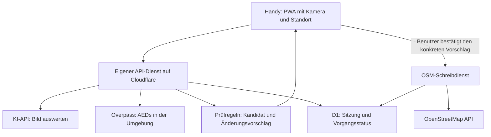

# Architektur und Bedienung für AEDjaeger

Stand: **19.10.2026**. Cloudflare ist als Hosting-Richtung gewählt. Ein lokaler, simulierter Bedienprototyp wird mit Vite und TypeScript ohne React umgesetzt; produktive Dienste und Deployment haben noch nicht begonnen. GPT-6 Luna ist als erstes Bildmodell festgelegt; die App-Anbindung steht noch aus. Die Produktvorgabe bleibt: **Foto → vorhandenen AED bestätigen oder neuen eintragen → kurz bestätigen → fertig.**

## 1. Empfehlung

**Eine installierbare PWA mit einem kleinen Serverdienst. GitHub bleibt der Speicherort für Code, Dokumentation und Tests. App und Serverdienst laufen gemeinsam auf Cloudflare Workers mit Static Assets. Eine kleine D1-Datenbank hält Sitzungen und den Status von Schreibvorgängen.**

Die zusätzliche Serverseite hat einen konkreten Zweck: KI-Zugang schützen, Kosten begrenzen und OSM-Schreibvorgänge auch nach einem Verbindungsabbruch nachvollziehen können. Sie ist keine eigene AED-Datenbank; OpenStreetMap bleibt die maßgebliche Datenquelle.

### Hosting-Alternativen

| Variante | Eignung | Abwägung |
| --- | --- | --- |
| Nur GitHub Pages | Für eine öffentliche App mit geheimem KI-Schlüssel unzureichend | Pages liefert statische Dateien; ein im Browser eingebauter Schlüssel wäre auslesbar. |
| GitHub Pages plus separater API-Dienst | Technisch möglich | Vertrautes Frontend-Hosting, aber zwei Deployments und gegebenenfalls zusätzliche Origin-, Cookie- und CORS-Konfiguration. |
| Cloudflare Workers mit Static Assets und D1 | **Empfehlung für dieses Projekt** | Oberfläche und API unter derselben Domain, ein zusammenhängendes Deployment, verwalteter Betrieb. Dafür ein zusätzliches Betreiberkonto und Bindung an dessen Dienste. |
| Verwaltetes Node-Backend oder eigener Server | Mögliche Alternative | Mehr Betriebsaufwand; für die ersten Funktionen kein erkennbarer Vorteil. Ein EU-Hosting-Anbieter wäre zu prüfen, falls verbindliche Datenresidenz ein Ziel wird. |
| Native Android-/iOS-App | Spätere Option | Mehr Plattform- und Veröffentlichungsarbeit; löst weder KI-Fehler noch ungenaues Indoor-GPS. Erst bei nachgewiesenen PWA-Grenzen neu entscheiden. |

GitHub beschreibt Pages als statisches Hosting. Google warnt ausdrücklich vor KI-Schlüsseln in ausgelieferten Web-Apps. Cloudflare kann statische Dateien und API-Routen in einem Worker-Projekt bereitstellen. Die Empfehlung, diese Möglichkeiten hier zu kombinieren, ist unsere Architekturentscheidung. Quellen: [GitHub Pages](https://docs.github.com/en/pages/getting-started-with-github-pages/what-is-github-pages), [Gemini-Schlüsselschutz](https://ai.google.dev/gemini-api/docs/api-key), [Workers Static Assets](https://developers.cloudflare.com/workers/static-assets/), [D1](https://developers.cloudflare.com/d1/).

### Kostenarm starten

Für Prototyp und kleinen Pilot ist zunächst der Cloudflare-Free-Tarif vorgesehen; die monatliche Mindestgebühr des Workers-Paid-Tarifs ist keine Startvoraussetzung. Statische Assets werden laut Cloudflare kostenlos und ohne Mengenlimit ausgeliefert. Workers Free hat derzeit ein Kontingent von 100.000 Aufrufen pro Tag und 10 ms CPU-Zeit pro Aufruf; D1 hat eigene Tages- und Speichergrenzen. Werden Grenzen überschritten, können API-Aufrufe fehlschlagen, statt unbemerkt kostenpflichtig weiterzulaufen. Workers Paid (mindestens 5 USD pro Monat) wird erst erwogen, wenn ein konkreter Bedarf die Free-Grenzen überschreitet oder der Betrieb es erfordert. Zunächst kann die Cloudflare-Subdomain verwendet werden; eine eigene Domain ist optional und kann Kosten verursachen. [Workers-Preise](https://developers.cloudflare.com/workers/platform/pricing/), [Limits](https://developers.cloudflare.com/workers/platform/limits/), [Static-Assets-Abrechnung](https://developers.cloudflare.com/workers/static-assets/billing-and-limitations/), [D1-Preise und Free-Kontingent](https://developers.cloudflare.com/d1/platform/pricing/).

Ein privates GitHub-Repository allein macht eine veröffentlichte Website nicht privat. Auch die Testumgebung benötigt deshalb eine eigene Zugangsbeschränkung. Bei GitHub Pages hängt die Veröffentlichung aus privaten Repositories außerdem vom GitHub-Tarif ab. [GitHub-Dokumentation](https://docs.github.com/en/pages/getting-started-with-github-pages/github-pages-limits)

## 2. Bedienung: drei kurze Ansichten

### Start und Aufnahme

Heller Hintergrund, dunkle Schrift, grüner Hauptknopf, große Bedienelemente im unteren Bereich. Eine gut lesbare Textmeldung begleitet jedes Symbol; Grün bezeichnet keine garantierte medizinische Einsatzbereitschaft. Kein Dashboard und keine Karte als Startseite.

```text
AEDjaeger                         Hilfe

Einen AED entdeckt?
Fotografiere das Gerät.

        [ AED fotografieren ]

Offene Aufnahme fortsetzen       Konto
```

Nach der ersten bewussten Betätigung öffnet die Kamera. Für wiederkehrende Nutzer kann die App direkt eine Kameraansicht anbieten, soweit der Browser dies erlaubt. Browserberechtigungen und gelegentlich erneute OSM-Anmeldung lassen sich nicht vollständig wegdesignen.

Vor der ersten Analyse einmal verständlich erklären, an welchen KI-Dienst das Bild geht. Standortberechtigung erst im Zusammenhang mit der Aufnahme erfragen. Die OSM-Anmeldung sollte beim ersten produktiven Durchlauf erfolgen und anschließend möglichst erhalten bleiben. Der Bildentwurf muss eine Login-Weiterleitung überleben.

### Während der Prüfung

Das aufgenommene Foto bleibt sichtbar. Darunter steht „Foto und Umgebung werden geprüft“. Im Hintergrund laufen Bildauswertung und Umgebungssuche parallel. Fortschritt nur anzeigen, wenn er tatsächlich messbar ist; keine erfundene Prozentanzeige.

Bei längerer Wartezeit bleibt „Für später aufheben“ erreichbar. Ein Timeout verliert weder das Foto noch eine bereits erfolgreiche Teilauswertung.

### Ergebnis und Speichern

Bekannter AED:

```text
AED gefunden
Rathaus · Eingang rechts

Schon in OpenStreetMap eingetragen.
Du bestätigst: Dieses Gerät ist noch da.

       [ Noch vorhanden bestätigen ]
              Anderer Standort
```

Neuer AED:

```text
Neuen AED eintragen

[Foto]       [kleine Standortvorschau]
Erkannt: AED im Eingangsbereich

         [ In OpenStreetMap speichern ]
                 Angaben ändern
```

Die Standortvorschau ist ein Vorschlag zur Absicherung einer Neuanlage und keine zusätzliche verpflichtende Kartenseite. Das Foto verrät nicht die exakte geografische Geräteposition. In einem Gebäude oder bei schlechtem GPS ist gegebenenfalls einmaliges Korrigieren nötig. Wenn die Lage nicht belastbar bestimmbar ist, bleibt ein Entwurf erhalten.

Nach bestätigtem OSM-Erfolg: „Gespeichert“ und „Nächsten AED fotografieren“. Keine Belohnungsanimation, die den nächsten Vorgang verzögert. Optional ist ein Link zum OSM-Objekt erreichbar.

### Gestaltungsregeln

- Ein Hauptknopf pro Ansicht; mindestens etwa 48 CSS-Pixel hohe Tippflächen als Gestaltungsziel.
- Keine OSM-Tag-Namen, KI-Konfidenzwerte oder Rohfehlermeldungen in der normalen Bedienung.
- Rückfragen möglichst als kurze Auswahl, etwa „Erdgeschoss / anderes Stockwerk / weiß ich nicht“.
- Unbekannte optionale Angaben bleiben leer. Ein bestehender AED muss nicht vervollständigt werden.
- Lesbar bei großer Schrift, mit Screenreader und ohne Farberkennung; keine ausschließlich durch Ziehen bedienbare Karte.
- Die Installation auf dem Startbildschirm ist optional. Derselbe Ablauf funktioniert zunächst auch im Browser.

## 3. Sprachen von Anfang an

Die erste Version soll vollständig auf Deutsch, Englisch, Polnisch, Japanisch, Französisch und Spanisch nutzbar sein. Die Oberfläche nutzt die Sprache des Geräts als Startwert und bietet eine gut erreichbare manuelle Auswahl. Die Wahl bleibt gespeichert.

Alle Ansichten, Fehlerzustände, Login-Rückkehr, Fotoerklärung, Datenschutztexte, Rückfragen und Statusmeldungen müssen lokalisiert werden. Nicht sichtbare Hilfetexte für Screenreader und Browser-Metadaten wie `lang` gehören ebenso dazu. Datum, Zahl, Zeit und gegebenenfalls Adressformat richten sich nach Locale. Layouts werden mit langen deutschen und spanischen Texten sowie polnischen und französischen Sonderzeichen, japanischen Zeichen und dynamischer Schriftgröße geprüft.

Die KI liefert sprachunabhängige Beobachtungen und rohe, klar gekennzeichnete Beschriftung. Sie soll keine UI-Texte übersetzen. AED-Tags und OSM-Werte werden fachlich unverändert gespeichert; eine Beschreibung wird nicht unbemerkt in mehrere Sprach-Tags kopiert. Für Glossar, kurze Rückfragen und Feldnamen gibt es im Repository eine feste deutsche Referenz und geprüfte Übersetzungen. Agentengenerierte Übersetzungen allein gelten nicht als überprüft.

## 4. Gamification im Hintergrund

Das [AED-Signalnetz](gamification.md) ist das vorgeschlagene Gemeinschaftskonzept. Im normalen Ablauf gibt es keine Level-, Punkte- oder Ranglistenansicht. Eine Gemeinschaftskarte kann nach gemeinsam erreichten, ausreichend anonym aggregierten Vor-Ort-Prüfungen freiwillig geteilt werden. Sie ist kein Bestandteil des ersten funktionierenden Uploads.

Im Pilot bleibt Gamification für Nutzende vollständig unsichtbar. Intern werden erfolgreiche Vor-Ort-Beobachtungen erst nach OSM-Bestätigung gezählt; es gibt keine öffentliche Anzeige und keine Teilfunktion. Keine Rohfotos, exakten Bewegungsprofile oder Nutzer-Ranglisten für diesen Zweck speichern. Neuanlage und Existenzprüfung zählen gleichwertig; Wiederholungen desselben Standorts am selben Tag werden nicht mehrfach gezählt. Teilen und öffentliche Fortschrittsanzeigen werden frühestens nach dem Pilot separat bewertet. Gamification ändert weder Erkennungs- und Sicherheitsregeln noch erlaubte OSM-Patches.

## 5. Technischer Aufbau



### Vorgeschlagener Stack

| Teil | Vorschlag | Zweck |
| --- | --- | --- |
| Oberfläche | TypeScript, Vite, einfache CSS-Regeln | Der lokale Prototyp nutzt kein React: Für den schmalen Ablauf reicht ein kleines Zustandsmodul, und zusätzliche Laufzeitbibliotheken entfallen. |
| PWA | Manifest und Service Worker mit kontrollierten Updates | Installierbarkeit, schneller Start und Wiederaufnahme offener Vorgänge. |
| Karte | Leaflet erst laden, wenn benötigt | Bekannter Baustein aus Hydrantenjäger; kein Kartenaufwand auf dem Startbildschirm. |
| Server | TypeScript in Cloudflare Workers | KI-Anbindung, Anmeldung, Prüfung und OSM-Schreibzugriffe. |
| Datenprüfung | Gemeinsame Laufzeitschemas, beispielsweise mit Zod | KI-Antworten und Browseranfragen an der Servergrenze validieren. |
| Kleiner persistenter Speicher | D1 | Sitzungen, freigegebene Vorschläge, Uploadstatus und Verbrauchszähler. |
| Lokale Entwürfe | IndexedDB | Foto und Aufnahmezustand nach Login, Neuladen oder Netzverlust fortsetzen. |
| Prüfung | Vitest und Playwright; reale Mobilgeräte ergänzen | Fachlogik, API-Fehlerfälle und vollständige Benutzerabläufe absichern. |

Die erste Implementierungsentscheidung ist Vite mit TypeScript ohne React. Sollte der Ablauf später deutlich mehr interaktive Ansichten benötigen, kann React separat begründet geprüft werden; ein spontaner Frameworkwechsel ist nicht Teil des Prototyps.

Hydrantenjäger liefert geprüfte Ausgangspunkte für Kamera, OSM-XML, OAuth, Standortkorrektur und PWA-Updates. Geeignete Bausteine gezielt übernehmen und Herkunft festhalten. Die gesamte App zu kopieren würde auch unnötige Hydrantenlogik und bestehende Annahmen zur Positionierung übernehmen.

## 6. KI-Aufgabe eng begrenzen

Die KI erhält das verkleinerte, korrekt gedrehte Foto und eine feste Extraktionsanweisung. Sie liefert strukturierte Beobachtungen, etwa:

```json
{
  "scene": "device_visible",
  "device_count": 1,
  "readable_text": ["AED"],
  "manufacturer": null,
  "model": null,
  "location_clues": [],
  "image_issues": []
}
```

Das ist ein vorgeschlagener Vertrag, keine bereits getestete API-Antwort. Zu den unterscheidbaren Bildfällen gehören sichtbares Gerät, geschlossener Kasten, reiner Wegweiser, leere Halterung, mehrere Geräte, anderes Objekt und unklar.

**Die KI erzeugt keine freien OSM-Tags und führt keine Schreibwerkzeuge aus.** Feste Anwendungsregeln übersetzen geprüfte Beobachtungen in einen Vorschlag. Aus einem grünen Schild wird keine sichere Gerätebestätigung; aus einem Foto bei Tageslicht werden keine Öffnungszeiten. Hersteller und Modell werden nur bei klar lesbarer Beschriftung angeboten. Seriennummern, Namen und Telefonnummern werden nicht beiläufig übernommen.

Text im Foto und bestehende OSM-Beschreibungen sind fremde Daten. Anweisungen wie „ignoriere die Regeln“ müssen als Bildinhalt behandelt werden. Die KI erhält weder OSM-Token noch API-Schlüssel, freien Webzugriff oder die Möglichkeit, weitere URLs aufzurufen. Auch valide JSON-Antworten können sachlich falsch sein; das Schema ersetzt keine fachliche Prüfung.

Gemini, OpenAI und Anthropic bieten Bildauswertung an; Gemini stellt außerdem strukturierte Ausgaben bereit. Das belegt noch keine ausreichende AED-Erkennung. Quellen: [Gemini Bilder](https://ai.google.dev/gemini-api/docs/image-understanding), [Gemini strukturierte Ausgaben](https://ai.google.dev/gemini-api/docs/structured-output), [OpenAI Bildverständnis](https://developers.openai.com/api/docs/guides/images-vision), [Claude Vision](https://docs.anthropic.com/en/docs/build-with-claude/vision).

### Anbieterwahl

Für die erste API-Integration ist auf ausdrückliche Nutzerentscheidung **OpenAI GPT-6 Luna (`gpt-6-luna`)** festgelegt. Für AEDjaeger darf kein höheres OpenAI-Modell verwendet werden. Die API-Schlüsselauthentifizierung wurde geprüft; eine einzelne explorative Bildanfrage mit drei positiven Testfotos erkannte alle drei als AED. Das ist ein erster Machbarkeitstest, aber kein kontrollierter Vergleich und kein Nachweis ausreichender Zuverlässigkeit: negative und unklare Fälle, Wiederholungen und ein vorab annotierter Testsatz fehlen noch. GPT-6 Luna unterstützt Bildeingaben und ist für kostensensible Aufgaben positioniert. [OpenAI: Modelle](https://developers.openai.com/api/docs/models), [Bildverständnis](https://developers.openai.com/api/docs/guides/images-vision).

ChatGPT-Abos enthalten keine API-Nutzung; API-Guthaben und API-Abrechnung sind davon getrennt. Der erste OpenAI-API-Aufruf erfolgte nach Prüfung des vorhandenen Guthabens und eines gesetzten Ausgabenlimits. Nutzerfotos aus dem späteren Betrieb werden nicht automatisch an mehrere Anbieter geschickt oder für einen Anbietervergleich wiederverwendet. Ein späterer Modell- oder Anbieterwechsel verlangt eine ausdrückliche Produktentscheidung, erneute Auswertung der Tests und gegebenenfalls angepasste Nutzerinformationen. [OpenAI: ChatGPT- und API-Abrechnung](https://help.openai.com/en/articles/9039756-managing-billing-for-chatgpt-and-the-api-platform).

Für manuelle Tests und weitere Modellprüfungen nur eigens aufgenommene oder rechtmäßig nutzbare, nicht sensible Bilder ohne erkennbare Personen verwenden. Vor jeder weiteren Übermittlung echte Fotos, den konkreten Anbieter und etwaige Ausgaben prüfen; frühere Freigaben gelten nur für die ausdrücklich benannten Testbilder. Die Bedingungen für Aufbewahrung und Verarbeitung beim ausgewählten Dienst müssen vor einem Pilot verständlich erklärt werden. [OpenAI-Datenkontrollen](https://developers.openai.com/api/docs/guides/your-data).

Die im Chrome-Browser integrierte Prompt API ist derzeit keine Basis für diese mobile App: Die offizielle Dokumentation führt Android und iOS als nicht unterstützt auf. Chrome bleibt ein Entwicklungs- und Testwerkzeug. [Chrome Prompt API, geprüft am 17.10.2026](https://developer.chrome.com/docs/ai/prompt-api)

## 7. Der schwierigste Teil: den richtigen AED zuordnen

### Informationen zusammenführen

Die App verbindet den zeitnah zur Aufnahme ermittelten Standort mit seiner angegebenen Genauigkeit, OSM-Kandidaten, sichtbaren Hinweisen und gegebenenfalls einer kurzen Benutzerantwort. Die Browserangabe zur Genauigkeit ist eine Schätzung, kein Beweis einer exakten Position. [Geolocation-Dokumentation](https://developer.mozilla.org/en-US/docs/Web/API/GeolocationCoordinates/accuracy)

Ein Suchradius von beispielsweise mindestens 100 Metern, erweitert bei ungenauem Standort bis zu einem begrenzten Maximum, kann ein Startwert für Versuche sein. **Das ist keine Zuordnungsregel und kein fertiger Grenzwert.** Ein einziger Treffer innerhalb dieses Radius ist noch kein Beweis. Standortbeschreibung, Eingang, Ebene und Widersprüche entscheiden mit. Gleiches Gerätemodell ist kein eindeutiges Identifikationsmerkmal.

Erst nach erfolgreicher Suche im relevanten Bereich darf eine Neuanlage angeboten werden. Ein Fehler, veralteter Cache, zu kleiner Suchausschnitt oder unvollständige Antwort darf nie als „kein Gerät vorhanden“ erscheinen. Die Abdeckung der Suche muss sowohl Geräteposition als auch GPS-Unsicherheit berücksichtigen. Bei extremer Unsicherheit wird die Position geklärt, statt immer größere Gebiete abzufragen.

### Zuordnungsregeln

- Eindeutig plausibler Kandidat ohne Widerspruch: Standortbeschreibung in der Bestätigung zeigen.
- Mehrere plausible Kandidaten: eine kurze, unterscheidbare Auswahl anbieten.
- Kein plausibler Kandidat nach vollständiger Suche: Neuanlage samt Standortvorschau.
- Unklare Lage oder widersprüchliche Hinweise: eine passende Rückfrage oder Entwurf.
- Ein bereits vorhandener AED wird nicht wegen einer abweichenden Handyposition verschoben.
- Ungewöhnliche OSM-Objekte, etwa als Gebäude erfasste AEDs, nicht automatisch in Knoten umwandeln. Vorerst gesondert behandeln.

Overpass ist für die Kandidatensuche geeignet, kann gegenüber OSM verzögert sein. Vor einer Neuanlage im Pilotprojekt zusätzlich einen kleinen, aktuellen OSM-Kartenausschnitt prüfen, soweit die Bearbeitungs-API dies innerhalb ihrer Grenzen zulässt. Kein massenhaftes Kartenladen über die Schreib-API. Schlägt die Prüfung fehl, bleibt die Neuanlage offen. [OSM API-Nutzungsregeln](https://operations.osmfoundation.org/policies/api/)

Vollständige Vermeidung zeitgleicher Neuanlagen durch verschiedene externe OSM-Editoren ist dadurch nicht garantiert. Innerhalb unserer App können Wiederholungen und konkurrierende Vorgänge erkannt werden; auffällige Dubletten müssen im Pilotbetrieb trotzdem kontrolliert werden.

## 8. Bestehenden AED bestätigen

**Korrektur zur früheren Sammlung:** Die aktuelle OSM-Dokumentation beschreibt `check_date=YYYY-MM-DD` ausdrücklich auch für die zuletzt überprüfte Existenz eines Objekts. Für „noch vorhanden“ empfehlen wir deshalb diesen Tag. Andere Angaben bleiben unverändert; Änderungen an Zugangszeiten brauchen eine eigene Beobachtung. [OSM: check_date](https://wiki.openstreetmap.org/wiki/Key:check_date)

Bei derselben Bestätigung am gleichen Tag ist kein erneuter identischer Upload nötig. Ein älteres Offline-Foto darf ein neueres Prüfdatum nicht zurücksetzen. Verwendet wird das bestätigte Beobachtungsdatum, nicht automatisch das spätere Uploaddatum. Ein aus der Galerie gewähltes Foto belegt weder eine heutige Aufnahme noch den aktuellen Standort; der Ersatzweg muss Datum und Ort klären.

Ein sichtbares Gerät oder eine bewusste Vor-Ort-Bestätigung ist erforderlich. Ein geschlossener und nicht einsehbarer Kasten allein genügt nicht. Die App spricht stets von „vorhanden“, nicht von „gewartet“, „funktionsfähig“ oder „jederzeit zugänglich“.

## 9. Zuverlässig nach OSM schreiben

Der Server erzeugt nach der Analyse einen zeitlich begrenzten Änderungsvorschlag, gebunden an Benutzer, Aufnahme und die gelesene OSM-Version. Der Browser bestätigt genau diesen Vorschlag. Der Server akzeptiert keine beliebigen OSM-XML-Inhalte oder frei gewählten URLs vom Client.

Jeder Vorgang bekommt eine eindeutige ID. Vor der Übermittlung werden Benutzerfreigabe und beabsichtigte Änderung dauerhaft gespeichert. Ein wiederholtes Tippen oder Wiederholen derselben HTTP-Anfrage liefert den Status dieses Vorgangs. Es darf keinen zweiten unabhängigen Schreibvorgang starten.

Ablauf des Schreibdienstes:

1. Benutzer, freigegebenen Vorschlag und frischen Datenstand prüfen.
2. Änderungen auf erlaubte Felder begrenzen. Bei Existenzbestätigung nur das Datum ändern.
3. Änderungen anderer Mapper erhalten; einen Versionskonflikt nicht blind überschreiben. Wenn sich Objektidentität oder Bedeutung geändert haben, den Vorschlag erneut anzeigen.
4. Changeset öffnen und dessen ID vor dem Objekt-Upload im Vorgang hinterlegen.
5. Die kleine Änderung über einen einzelnen Diff-Upload senden, Ergebnis mit Objekt-ID und Version speichern.
6. Changeset schließen. Misslingt nur das Schließen, den erfolgreichen Objekt-Upload nicht wiederholen.

OSM nutzt Objektversionen zur Konfliktkontrolle. Ein kompletter Changeset ist nicht automatisch eine Transaktion; ein einzelner Diff-Upload kann Änderungen gemeinsam übertragen. [OSM API v0.6](https://wiki.openstreetmap.org/wiki/API_v0.6)

### Wenn die Verbindung nach dem Senden abbricht

„Keine Antwort“ bedeutet nicht „nicht gespeichert“. Der Zustand wird **Ergebnis unklar**. Die App liest den Vorgangsstatus und der Server prüft das bekannte Changeset sowie den aktuellen Objektstand. Solange der Ausgang nicht feststeht, bleibt ein erneuter Create-Aufruf gesperrt. Ein abgelaufenes internes Zeitlimit allein darf keine erneute Neuanlage auslösen.

Diese Vorsicht kann selten einen Vorgang zur manuellen Klärung offen lassen. Das ist besser als ein fälschlich angezeigter Erfolg oder eine doppelte Anlage. Im Pilotbetrieb braucht der Betreiber eine einfache Übersicht unklarer Vorgänge; kein riesiges Verwaltungsportal.

## 10. Anmeldung, Kosten und Fotoverarbeitung

### OSM-Konto

OSM OAuth 2.0 mit PKCE; die Anmeldung findet bei OSM statt. Der eigene Dienst verwaltet eine Sitzung und hält das OSM-Token verschlüsselt auf der Serverseite. Im Browser liegt nur eine zufällige Sitzungskennung als sicheres HttpOnly-Cookie. Zusätzlich: OAuth-State-Prüfung, CSRF-Schutz, Prüfung des Request-Ursprungs, Sitzungsrotation, begrenzte Laufzeit, Logout und Widerruf. Nur erforderliche Rechte anfordern. [OSM OAuth](https://wiki.openstreetmap.org/wiki/OAuth)

Dieser Vorschlag schützt Tokens vor direktem Auslesen durch Browser-JavaScript, macht den Server aber zum schützenswerten Tokenhalter. Verschlüsselungsschlüssel getrennt als Secret speichern; keine Tokens oder OAuth-Codes in Logs. Auch mit HttpOnly bleiben XSS-Abwehr und restriktive Sicherheitsheader notwendig.

### Kosten begrenzen

KI-Endpunkte nur für angemeldete Nutzer, anfangs für eine kleine freigeschaltete Gruppe. Größenlimit für Bilder, begrenzte Ausgabelänge, ein laufender Analysevorgang pro Aufnahme, Tageslimits pro Nutzer und globales Limit. Budget muss vor der KI-Anfrage atomar reserviert werden; parallele Anfragen dürfen die Grenze nicht umgehen. Nutzer- und IP-Limits ergänzen einander. CORS ist keine Zugriffskontrolle gegen direkte API-Aufrufe.

Provider-Budgetwarnungen sind kein verlässlicher sofortiger Ausgabestopp. Zusätzlich braucht die App ein eigenes Limit, einen Schalter zum Abschalten der Analyse und einen gesonderten Schalter für OSM-Schreibzugriffe. Wiederholungen zählen zum Budget; bei unklarer Abrechnung konservativ reservieren.

Workers Paid kostet mindestens 5 USD monatlich, ist für den ersten Prototyp aber nicht eingeplant. KI-Aufrufe, eine eigene Domain und späterer Mehrverbrauch können zusätzliche Kosten verursachen. Die KI-Kosten müssen unabhängig vom Hosting einzeln begrenzt werden. [Workers-Preise](https://developers.cloudflare.com/workers/platform/pricing/)

Keine erfundene Cent-Zahl pro Foto: Beim Vergleich die tatsächlich abgerechneten Bild-/Texttokens und Wiederholungen messen. Monatsprognose = Hosting + Domainanteil + Aufnahmen × gemessener mittlerer Analysepreis + Reserve. Ein zunächst vorgeschlagenes KI-Budget von z. B. 10 Euro pro Monat wäre eine Betreiberentscheidung, keine Prognose und wird hier nicht eingerichtet. [Gemini-Abrechnung](https://ai.google.dev/gemini-api/docs/billing)

### Fotos und personenbezogene Daten

Das Handy dreht und verkleinert Bilder vor dem Versand und entfernt unnötige EXIF-Metadaten. Als zu testender Ausgangspunkt: etwa 1.600–2.048 Pixel lange Kante, bei lesbarer Beschriftung; nicht so stark komprimieren, dass OCR unbrauchbar wird. Der Server prüft Dateityp, Größe und Abmessungen nochmals und akzeptiert keine externen Bild-URLs. Auch technisch gültige Dateien können die KI täuschen; die fachlichen Regeln bleiben erforderlich.

Der KI-Anbieter bekommt das Bild, möglichst ohne exakte GPS-Koordinaten oder OSM-Benutzeridentität. Die Zuordnung erfolgt separat. Der Server speichert Fotos regulär nicht dauerhaft und loggt keine Bilddaten oder vollständigen Modellantworten. Lokale Entwürfe erhalten einen sichtbaren Löschweg und werden nach Erfolg oder Verwerfen entfernt. Bei Browser-Speicherverlust kann ein lokaler Entwurf dennoch verloren gehen; keine Sicherungsgarantie versprechen.

„Wir speichern das Foto nicht dauerhaft“ ist nicht gleich „der KI-Anbieter speichert nichts“. Google beschreibt eigene Verarbeitungsbedingungen, einschließlich einer Sonderregel für EWR, Schweiz und UK; OpenAI nennt standardmäßige Missbrauchsprotokolle und weitere speicherungsabhängige Ausnahmen. Der ausgewählte Vertrag und die tatsächliche API-Konfiguration müssen zum Datenschutzhinweis passen. Ein EU-Nutzerkonto garantiert keine ausschließlich europäische Verarbeitung. [Gemini-Bedingungen](https://ai.google.dev/gemini-api/terms), [OpenAI-Datenkontrollen](https://developers.openai.com/api/docs/guides/your-data)

OSM-Bearbeitungen sind öffentliche Beiträge. Das ist beim ersten Verbinden des Kontos verständlich zu erklären. Private Fotos gehören nicht in ein öffentliches Test-Repository; echte Testbilder benötigen geklärte Nutzungsrechte und sollen möglichst keine Personen zeigen.

## 11. PWA-Grenzen bewusst berücksichtigen

Kamera und Standort sind auf HTTPS angewiesen und unterliegen Browserberechtigungen. Eine verweigerte Berechtigung braucht einen verständlichen Ersatzweg. Kameraauswahl, Bilddrehung, HEIC, Wechsel zu OSM und Rückkehr in eine installierte PWA müssen auf echten Geräten geprüft werden. [Kamera-API](https://developer.mozilla.org/en-US/docs/Web/API/MediaDevices/getUserMedia)

Offline kann die App eine Aufnahme vorbereiten und lokal behalten. Cloud-KI, aktueller OSM-Abgleich und Upload benötigen Netz. Wiederaufnahme beim nächsten Öffnen ist der verlässliche Hauptweg; Hintergrund-Synchronisation ist keine Voraussetzung. [MDN: Offline und Hintergrundbetrieb](https://developer.mozilla.org/en-US/docs/Web/Progressive_web_apps/Guides/Offline_and_background_operation)

Der Service Worker speichert die App-Oberfläche, aber keine OAuth-Antworten, Sitzungsausgaben oder Schreibanfragen. Aktualisierungen wechseln nicht mitten in einer Aufnahme die App-Version. Backend und gespeicherte Entwürfe brauchen versionierte Datenverträge, damit eine ältere installierte Oberfläche verständlich weiterarbeiten oder aktualisieren kann.

OSM-Kartenkacheln nicht pauschal für Offline-Gebiete herunterladen. Anbieterregeln und sichtbare Quellenangabe berücksichtigen; vor öffentlicher Nutzung einen passenden Kachelanbieter und dessen Kapazität festlegen. [OSM-Kachelregeln](https://operations.osmfoundation.org/policies/tiles/)

## 12. Fehlerrisiken und Gegenmaßnahmen

| Schwachpunkt | Vorbeugung | Nachweis im Prototyp |
| --- | --- | --- |
| Schild, Foto eines AED oder leerer Kasten wird als Gerät erkannt | Eigene Bildklassen, Unsicherheit zulassen, Bestätigung des tatsächlichen Vor-Ort-Geräts | Negative Beispiele und schwierige Fotos gezielt prüfen. |
| Falscher bestehender AED ausgewählt | Standortunsicherheit, Ebene und Beschreibung einbeziehen; keine reine Nächster-Punkt-Regel | Mehrere Geräte im selben Gebäude testen. |
| Gerät wird auf Handyposition statt Wandposition angelegt | Kleine Standortvorschau; bei Unsicherheit Korrektur | Innenraum, Straßenseiten und schlechte GPS-Fixes testen. |
| Veraltete Daten führen zur Dublette | Frische Suche und begrenzte aktuelle Vorprüfung | Verzögerte Overpass-Daten simulieren. |
| Netzabbruch erzeugt doppelte Anlage | Persistente Vorgangs-ID, Statusprüfung, unklaren Upload nicht wiederholen | Antwort nach erfolgreichem Upload absichtlich verlieren. |
| KI erfindet Tags | Beobachtungsschema, erlaubte Felder und serverseitige Übersetzung | Widersprüchliche Angaben und Bildanweisungen testen. |
| Bestehende Daten gehen verloren | Minimaler Patch auf aktuelle Version | Fremde Tags und Paralleländerungen prüfen. |
| API wird zum Kostentreiber | Anmeldung, Limits, atomare Reservierung, Abschalter | Parallelzugriffe, erneutes Laden und missbräuchliche Aufrufe testen. |
| Foto geht beim Login/Update verloren | Lokaler Entwurf und kontrollierte Updates | Neuladen, OAuth-Rückkehr und App-Wechsel prüfen. |
| Alte App passt nicht zur neuen API | Versionierte Verträge, kompatible Releases | Vorherige PWA-Version gegen neue API testen. |
| Erfolgsanzeige trotz offener Speicherung | Eindeutige Zustände, Erfolg nur aus bestätigtem Ergebnis | Timeout in jedem Schreibschritt testen. |
| Automatisch erzeugter Code hat nur scheinbar gute Tests | Unabhängige Erwartungsfälle, End-to-End-Tests und gezielte Fehlerauslösung | Siehe [Umsetzungsplan](umsetzungsplan.md). |

Die OSM-Regeln zu automatisierten Änderungen gelten insbesondere für systematische Änderungen ohne Betrachtung jedes Einzelfalls. Unser Entwurf zeigt den konkreten Standort und die geplante Änderung vor der Benutzerfreigabe. Vor einer breiten Einführung den tatsächlichen Ablauf dokumentieren und mit erfahrenen OSM-AED-Mappern prüfen; ein Bestätigungsknopf allein ist keine pauschale Ausnahme von Community-Regeln. [Automated Edits code of conduct](https://wiki.openstreetmap.org/wiki/Automated_Edits_code_of_conduct)

## 13. Was vor einem öffentlichen Start noch belegt werden muss

Keine Anbieterbeschreibung beweist, dass die Erkennung in unserer Situation zuverlässig genug ist. Ebenso wenig ist die Zuordnung nur durch eine gute Demo abgesichert. Zuerst müssen Bildauswertung, räumliche Zuordnung, Login-Rückkehr und Verhalten bei Netzverlust als durchgehender Ablauf funktionieren.

Erst danach sind zusätzliche Funktionen sinnvoll. Wenn gute Ergebnisse zu viele Rückfragen benötigen, verbessern wir zuerst diese Fälle. Wenn ein Gerät aus einem Foto nicht sicher zugeordnet werden kann, bleibt eine kurze Frage Teil des Produkts. Das Ziel ist ein sehr kurzer zuverlässiger Ablauf, keine versprochene Vollautomatik unter allen Bedingungen.
